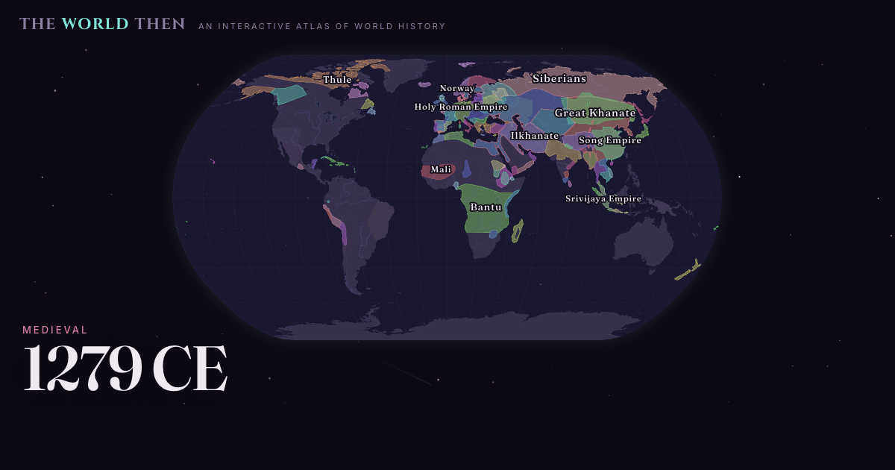

# The World Then



An interactive map of world history, from 2000 BCE to the present. Move
through time to explore changing territories, rulers, wars, cities,
religions, languages and local names. Free, with no accounts or tracking.

This is a public preview. Historical corrections and coverage improvements
are ongoing. Recent years use the latest bundled records, not live updates.

- **Use it:** https://theworldthen.com
- **Download:** [the-world-then.html](https://theworldthen.com/the-world-then.html).
  Save the file and open it in a browser. The map and bundled historical data
  work offline. Images and refreshed Wikipedia summaries need an internet
  connection; fonts fall back to system fonts when offline.
- **Methodology, sources and limitations:** [the About page](https://theworldthen.com/about.html)

## What is in this repository

This is the deployed site, served by GitHub Pages, together with the source of
its software.

| Path | What it is |
| --- | --- |
| `index.html`, `about.html`, `the-world-then.html`, `404.html` | the built pages the site serves |
| `source/` | `app.html`, `about.html` and `build.py`, the editable source, plus [`BUILDING.md`](source/BUILDING.md) |
| `data/` | the compiled dataset and basemap the app loads |
| `vendor/`, `fonts/` | bundled libraries and typefaces, each with its own license |
| `LICENSE.md` | the component-by-component license manifest |

From release 213 onward, releases are tagged `release-<number>`. The app's
Source link points to the matching release, including in the downloaded
version.

## Building

```
python3 source/build.py
```

Python 3, standard library only. It writes the three pages into the repository
root. See [`source/BUILDING.md`](source/BUILDING.md) for what the build reads
and how to run the result.

## Data

The dataset is compiled from [Wikidata](https://www.wikidata.org/),
[Wikipedia](https://en.wikipedia.org/), the
[historical-basemaps](https://github.com/aourednik/historical-basemaps) project
by A. Ourednik, and [Natural Earth](https://www.naturalearthdata.com/).

Borders are approximate. Source maps can be centuries apart in ancient history
and decades apart in more recent periods. The animation between them does not
show verified year-by-year changes. See the
[About page](https://theworldthen.com/about.html) for sources, snapshot dates
and known limitations.

## Licenses

The code, original content and third-party material have separate licenses.
[`LICENSE.md`](LICENSE.md) lists them in full.

- **Software** (the pages' markup, styles and scripts, and the build script):
  [The World Then Noncommercial ShareAlike License 1.0](LICENSE-TWT-NC-SA-1.0.txt),
  a custom license written for this project. It is not an open-source license.
  Noncommercial use is permitted. Shared changes must use the same software
  license, retain credits and identify modifications. Hosted versions,
  including unchanged copies, must offer matching source. Distributed
  noneditable versions must also include access to matching source. See the
  license and the About page's
  [Sharing section](https://theworldthen.com/about.html#use) for the full
  conditions and exceptions.
- **Original creative content** (the original dataset selection and curation,
  prose, visual design and sound design):
  [CC BY-NC-SA 4.0](https://creativecommons.org/licenses/by-nc-sa/4.0/).
- **Third-party material keeps its own licenses.** The historical border
  geometry is derived from historical-basemaps and stays
  [GPL-3.0](LICENSE-GPL-3.0.txt); Wikipedia text is CC BY-SA 4.0; Wikidata data
  is CC0; Natural Earth data is public domain; AUSTLANG name data is CC BY 4.0;
  d3 and topojson-client are ISC, flubber is MIT, and the Fraunces, Inter and
  Cinzel typefaces are SIL OFL 1.1. The full inventory is the About page's
  [Sources & licenses](https://theworldthen.com/about.html#sources) section.

Before release 213 (October 16, 2026) the software was offered under the
PolyForm Noncommercial License 1.0.0. Previously granted permissions remain in
effect. For commercial use, or anything these licenses do not cover, ask.

## Privacy

No accounts, analytics, tracking pixels or cookies. The About page's
[Privacy section](https://theworldthen.com/about.html#privacy) lists the
handful of settings the site keeps in your browser.

## Author

Created by Michael Manning with AI assistance. The About page explains how AI
was used. Corrections and questions are welcome: mikemanning1223@gmail.com.
